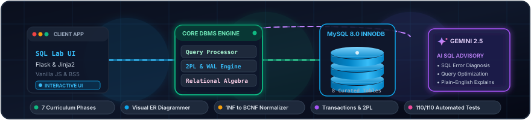
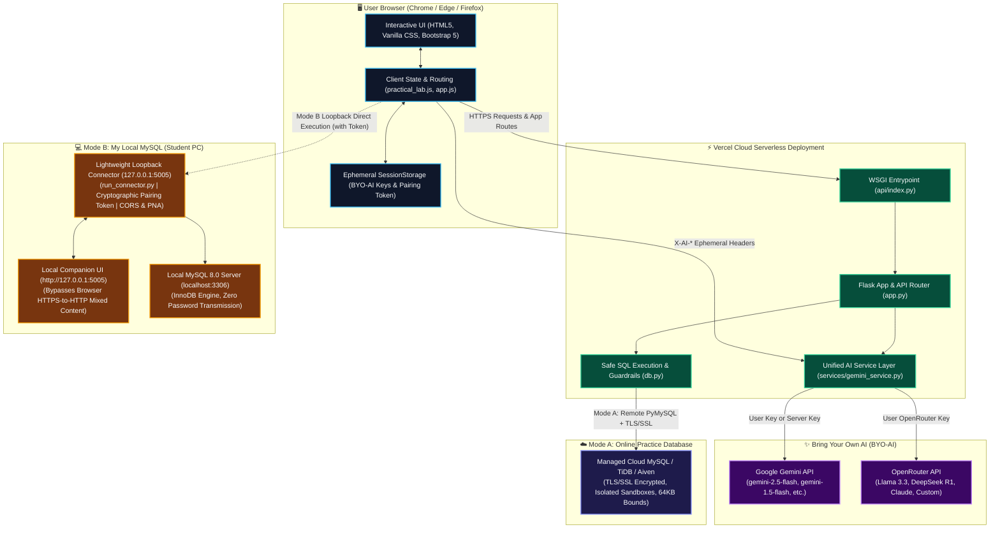

<div align="center">

# 🚀 DBMS Learn &amp; Run

### *Learn Database Concepts. Write SQL. Run. Understand.*

<!-- Animated Typing Tagline -->
<a href="https://github.com/Parth142007/DBMS-Learn-Run">
  
</a>

<br/>

<!-- Animated Database Architecture Visual -->
<a href="https://github.com/Parth142007/DBMS-Learn-Run">
  
</a>

<br/><br/>

<!-- Shields.io Badges -->
[](https://vercel.com/)
[](https://www.python.org/)
[](https://flask.palletsprojects.com/)
[](https://www.mysql.com/)
[](https://ai.google.dev/)
[](https://openrouter.ai/)
[](https://getbootstrap.com/)
[](tests/)
[](LICENSE)

</div>

---

## 📖 Table of Contents

1. [Project Overview](#1-project-overview)
2. [Key Features](#2-key-features)
   - [Phase 1: Architecture & Interactive SQL Laboratory](#phase-1--architecture--interactive-sql-laboratory)
   - [Phase 2: Introduction to DBMS (NEPC42)](#phase-2--introduction-to-dbms-nepc42)
   - [Phase 3: SQL & Relational Queries (NEPC42)](#phase-3--sql--relational-queries-nepc42)
   - [Phase 4: Views, Triggers & Security (NEPC42)](#phase-4--views-triggers--security-nepc42)
   - [Phase 5: Database Design & Normalization (NEPC42)](#phase-5--database-design--normalization-nepc42)
   - [Phase 6: ER & Relational Model (NEPC42)](#phase-6--er--relational-model-nepc42)
   - [Phase 7: Transactions & Concurrency (NEPC42)](#phase-7--transactions--concurrency-nepc42)
   - [AI-Powered DBMS Practical Lab (Gemini 2.5 Flash)](#ai-powered-dbms-practical-lab-gemini-25-flash)
3. [Technology Stack](#3-technology-stack)
4. [Screenshots & Interactive Previews](#4-screenshots--interactive-previews)
5. [System Architecture (Mermaid)](#5-system-architecture)
6. [Installation & Setup](#6-installation--setup)
7. [Environment Variables](#7-environment-variables)
8. [How to Run the Application](#8-how-to-run-the-application)
9. [☁️ Vercel Cloud Deployment Guide](#9-️-vercel-cloud-deployment-guide)
10. [🔌 Database Connection Modes (Mode A vs Mode B)](#10--database-connection-modes)
11. [✨ Bring Your Own AI Provider (BYO-AI)](#11--bring-your-own-ai-provider-byo-ai)
12. [Project Roadmap](#12-project-roadmap)
13. [Contributing](#13-contributing)
14. [License & Author](#14-license--author)

---

## 1. Project Overview

**DBMS Learn &amp; Run** is an interactive, full-stack educational web application inspired by the structured instructional pedagogical design of **GeeksforGeeks**. It was built specifically for computer science and engineering undergraduates studying the **NEPC42 Database Management Systems** syllabus.

### The Problem It Solves
Traditional database courses often present relational algebra, normalization proofs, and transaction concurrency as dry, static chalkboard theory. Meanwhile, standard browser-based SQL sandboxes execute mock in-memory SQLite tables that conceal real enterprise database mechanics.

### The Solution: Direct Local MySQL 8.0 Execution
Unlike static documentation or simulated sandboxes, **DBMS Learn &amp; Run connects directly to your local MySQL 8.0 Community Server (`localhost:3306`)**:
- **Real InnoDB Engine:** Queries execute on actual disk and buffer pool structures, reporting true execution latency, affected rows, and storage-level errors.
- **Hands-On Interactive Visualizers:** Step through transaction schedules, Armstrong's Axioms, BCNF decomposition proofs, and visual ER-to-DDL diagram generation.
- **Isolated Practice Workspaces:** Safe student sandboxes isolate experiments from core learning data.
- **AI-Assisted Guidance:** Integrated Google Gemini 2.5 Flash provides intelligent SQL error diagnoses, schema-aware query suggestions, and pedagogical explanations.

---

## 2. Key Features

### Phase 1 &mdash; Architecture &amp; Interactive SQL Laboratory
- **Live SQL Query Runner:** Execute custom SQL queries directly against MySQL 8.0 with real-time latency measurement in milliseconds and row counting.
- **Relational Schema Inspector:** Complete overview of all 8 core tables (`departments`, `students`, `courses`, `events`, `organizers`, `registrations`, `attendance`, `feedback`), displaying data types, primary keys, foreign keys, and nullability constraints.
- **Live Connection Monitor:** Real-time MySQL server status pill and connection diagnostic test modal on the top navigation bar.

### Phase 2 &mdash; Introduction to DBMS (NEPC42)
- **Database System Architectures:** In-depth breakdown and SVG diagrams of **1-Tier**, **2-Tier (Fat Client)**, and **3-Tier (Modern Web)** architectures with a 9-dimension comparative matrix.
- **Data Models:** Hierarchical (tree-based), Network (CODASYL graph), Relational (Codd tables), Entity-Relationship, and Object-Oriented models.
- **Three-Schema Architecture (ANSI/SPARC):** External (views), Conceptual (logical tables), and Internal (physical B+ Trees, raw disk blocks) schemas with mapping flow diagrams.
- **Data Independence Simulator:** Interactive simulator demonstrating physical data independence (NVMe migration, indexing) vs. logical data independence (entity splitting with view mapping).
- **University Exam Preparation:** Interactive quizzes and model answers for 2-mark, 5-mark, and 10-mark semester exam questions.

### Phase 3 &mdash; SQL &amp; Relational Queries (NEPC42)
- **DDL, DML, and DQL Deep-Dive:** Complete coverage of structural commands, constraints (`PK`, `FK`, `UNIQUE`, `CHECK`, `NOT NULL`, `DEFAULT`), and the 8-step Logical Query Processing Order (`FROM` &rarr; `JOIN` &rarr; `WHERE` &rarr; `GROUP BY` &rarr; `HAVING` &rarr; `SELECT` &rarr; `ORDER BY` &rarr; `LIMIT`).
- **The 5-Join Matrix:** Detailed tutorials and Venn diagrams for `INNER JOIN`, `LEFT JOIN`, `RIGHT JOIN`, `SELF JOIN` (hierarchical mentors), and `CROSS JOIN` (Cartesian product).
- **Aggregations &amp; Subqueries:** `GROUP BY`, `HAVING` clauses, scalar subqueries, multi-row subqueries (`IN`, `ANY`, `ALL`), and correlated subqueries with `EXISTS` and `NOT EXISTS`.
- **Sandbox Practice Safety:** Dedicated `practice_students` sandbox table with one-click REST table reset to prevent accidental data loss.

### Phase 4 &mdash; Views, Triggers &amp; Security (NEPC42)
- **Views &amp; Updatable Views:** Virtual tables, data abstraction, and hands-on `WITH CHECK OPTION` enforcement tests (`ERROR 1369`).
- **Triggers:** Automated event-driven programming covering all 6 trigger variations (`BEFORE`/`AFTER` `INSERT`/`UPDATE`/`DELETE`), `NEW`/`OLD` pseudorecords, and capacity limits via `SIGNAL SQLSTATE '45000'`.
- **Constraint Laboratory:** Interactive tests triggering MySQL errors for duplicate PKs (Error 1062), missing required columns (Error 1048), invalid FKs (Error 1452), and CHECK violations (Error 3819).
- **Stored Procedures:** Pre-compiled routines (`IN`, `OUT`, `INOUT` parameters) with live execution timing and multi-row result sets.
- **Database Security &amp; RBAC:** Authentication vs. Authorization, Principle of Least Privilege (PoLP), MySQL 8 Roles, and secure parameterized queries vs. SQL injection.

### Phase 5 &mdash; Database Design &amp; Normalization (NEPC42)
- **Modification Anomalies:** Interactive demonstrations of Insertion, Update, and Deletion anomalies in unnormalized relations.
- **Functional Dependencies:** Trivial, non-trivial, full, partial, and transitive dependencies.
- **Armstrong's Axioms:** Reflexivity, Augmentation, Transitivity, Union, Decomposition, and Pseudotransitivity inference tools.
- **Normal Form Progression:** 
  - **1NF:** Atomic attribute values and removal of repeating groups.
  - **2NF:** Elimination of partial functional dependencies on composite keys.
  - **3NF:** Elimination of transitive dependencies for non-prime attributes.
  - **BCNF:** Strict superkey enforcement for every non-trivial determinant.
- **Decomposition Theorems:** Binary Lossless Join test (`(R1 ∩ R2) → R1` or `(R1 ∩ R2) → R2`) and dependency preservation verifiers.
- **Normalization Practice Lab:** 5 comprehensive real-world case studies with step-by-step mathematical reasoning.

### Phase 6 &mdash; ER &amp; Relational Model (NEPC42)
- **Conceptual Modeling:** Chen classical notation vs. Crow's Foot notation, entity sets, weak entities, and partial discriminators.
- **Extended ER (EER):** Specialization, Generalization, disjoint/overlapping constraints, and completeness constraints.
- **7-Step ER-to-Relational Mapping:** Algorithmic conversion of strong entities, weak entities, 1:1, 1:N, M:N relations, and multivalued attributes into MySQL tables.
- **Interactive Relational Algebra Lab:** Live in-memory evaluator executing Selection ($\sigma$), Projection ($\pi$), Cartesian Product ($\times$), Natural Join ($\bowtie$), Union ($\cup$), and Set Difference ($-$) with cardinality and degree statistics.
- **Visual ER Diagram Builder:** Drag-and-drop / click-to-connect ER canvas that generates clean, ready-to-run MySQL DDL (`CREATE TABLE`) with foreign key constraints.

### Phase 7 &mdash; Transactions &amp; Concurrency (NEPC42)
- **ACID Guarantees &amp; Transaction States:** Atomicity, Consistency, Isolation, Durability, and the 6-state lifecycle (`ACTIVE`, `PARTIALLY COMMITTED`, `COMMITTED`, `FAILED`, `ABORTED`, `TERMINATED`).
- **5 Concurrency Anomalies:** Step-by-step interleaved schedule simulations for Lost Updates ($WW$), Dirty Reads ($WR$), Non-Repeatable Reads ($RW$), Phantom Reads, and Inconsistent Summaries.
- **Precedence Graph (Serialization Graph):** Automated conflict serializability analyzer with cycle detection and topological sorting.
- **Concurrency Control Protocols:** Two-Phase Locking (2PL: Basic, Conservative, Strict, Rigorous), lock conversion, and lock tables.
- **Deadlock Management:** Coffman conditions, Wait-For Graph (WFG) cycle detection, and victim selection with rollback.
- **Crash Recovery &amp; WAL:** Write-Ahead Logging (Force/No-Force, Steal/No-Steal), PageLSN, FlushedLSN, and ARIES-style Redo/Undo passes.
- **MySQL InnoDB MVCC:** Multi-Version Concurrency Control, Read Views, and Next-Key locking preventing phantom rows.

### AI-Powered DBMS Practical Lab (Gemini 2.5 Flash)
- **Dedicated University Lab Workspace:** Accessible at `/practical-lab` for completing teacher-assigned database practicals.
- **Multi-Statement Script Execution:** Execute multi-line MySQL 8 scripts (`CREATE TABLE`, `INSERT`, `ALTER`, `SELECT`) with detailed per-statement statuses.
- **Workspace Isolation:** Safe student workspace databases (`college_practical`, `dbms_practice_*`) with strict system catalog protections.
- **Google Gemini 2.5 Flash Advisory Engine:**
  - 🔍 **Check My SQL:** Validates SQL logic against teacher problem statements and table structures.
  - 📖 **Explain My Program:** Plain-English pedagogical walkthrough of relational concepts.
  - 🐛 **Find Errors:** Pinpoints compile-time typos, syntax errors, and foreign key violations.
  - 💡 **Suggest Correction:** Visual side-by-side **Compare Diff** modal with copy and insert buttons.
  - ⚡ **Generate SQL for My Task:** Translates natural language requirements into optimized MySQL 8 DDL/DML.
  - 📊 **Explain Query Output:** Translates returned rows and columns into educational takeaways.

---

## 3. Technology Stack

| Layer | Technology | Version | Purpose |
| :--- | :--- | :--- | :--- |
| **Backend Framework** | [Flask](https://flask.palletsprojects.com/) | `2.3+` | Lightweight REST API routing and Jinja2 server-side rendering |
| **Language Runtime** | [Python](https://www.python.org/) | `3.12` | Core backend logic, AST parsing, and testing framework |
| **Database Server** | [MySQL Community Server](https://www.mysql.com/) | `8.0` | Production relational database engine with InnoDB storage |
| **Database Driver** | [PyMySQL](https://github.com/PyMySQL/PyMySQL) / `mysql-connector-python` | `1.1+` | Pure-Python MySQL client driver with timeout and error handling |
| **AI Advisory Engine** | [Google GenAI SDK](https://github.com/google-gemini/google-genai) / OpenRouter | `gemini-2.5-flash` | Educational SQL assistance, error diagnosis, and query explanation |
| **Frontend UI** | [HTML5](https://developer.mozilla.org/) &amp; [CSS3](https://developer.mozilla.org/) | Modern Standard | Accessible markup with glassmorphism and responsive design |
| **Styling Framework** | [Bootstrap](https://getbootstrap.com/) &amp; [Bootstrap Icons](https://icons.getbootstrap.com/) | `5.3.3` | Responsive grid, interactive modals, tabs, and component cards |
| **Client Scripting** | Vanilla [JavaScript](https://developer.mozilla.org/) | `ES6+` | Zero-build client logic, AJAX API dispatch, and DOM rendering |
| **Automated Testing** | `unittest` | Built-in | 110 automated unit tests with 100% pass rate across all phases |

---

## 4. Screenshots &amp; Interactive Previews

### Animated Interactive SQL Terminal Execution
The platform provides a real-time terminal query runner connected to MySQL 8.0:

<div align="center">
  
</div>

<br/>

### Platform Interactive Modules Overview

```text
┌────────────────────────────────────────────────────────────────────────────────────────┐
│                                 DBMS LEARN & RUN PLATFORM                              │
├──────────────────────────┬──────────────────────────┬──────────────────────────────────┤
│    VISUAL ER BUILDER     │   NORMALIZATION LAB      │      TRANSACTION SIMULATOR       │
│  • Drag-and-drop canvas  │  • 1NF → BCNF pipeline   │  • Precedence serialization graph│
│  • Chen / Crow's foot    │  • Functional deps ($X⁺$)│  • 2PL lock table & waiting queue│
│  • Instant MySQL 8 DDL   │  • Lossless join tester  │  • ARIES WAL Redo/Undo crash lab │
├──────────────────────────┼──────────────────────────┼──────────────────────────────────┤
│    PRACTICAL AI LAB      │   SCHEMA INSPECTOR       │        JOIN & SQL LAB            │
│  • Gemini 2.5 Flash      │  • 8 University tables   │  • 5-Join matrix (INNER, OUTER)  │
│  • Side-by-side diffs    │  • Constraints & keys    │  • Aggregations & subqueries     │
│  • Isolated workspaces   │  • Live row count stats  │  • Real execution time in ms     │
└──────────────────────────┴──────────────────────────┴──────────────────────────────────┘
```

---

## 5. System Architecture

The following Mermaid diagram visualizes the request flow, execution isolation, and advisory feedback loop between the client browser, the Flask application server, local MySQL 8.0, and Google Gemini:



---

## 6. Installation &amp; Setup

### Prerequisites
- **Operating System:** Windows 10/11, macOS, or Linux.
- **Python:** Python `3.10` or higher (`3.12` recommended).
- **MySQL:** MySQL Server `8.0` or higher running locally on port `3306`.
- **Git:** Installed and configured.

---

### Step 1: Clone the Repository
Open PowerShell or your system terminal:
```powershell
git clone https://github.com/Parth142007/DBMS-Learn-Run.git
cd DBMS-Learn-Run
```

---

### Step 2: Create and Activate a Virtual Environment
```powershell
# Windows PowerShell
python -m venv venv
.\venv\Scripts\Activate.ps1

# Linux / macOS
python3 -m venv venv
source venv/bin/activate
```

---

### Step 3: Install Required Dependencies
```powershell
pip install -r requirements.txt
```

---

### Step 4: Configure Your Environment Variables
Copy the template configuration file:
```powershell
# Windows PowerShell
copy .env.example .env

# Linux / macOS
cp .env.example .env
```
Open `.env` in your text editor and set your local MySQL root password:
```ini
MYSQL_HOST=localhost
MYSQL_PORT=3306
MYSQL_USER=root
MYSQL_PASSWORD=your_actual_mysql_password
MYSQL_DATABASE=dbms_learn_run

# Optional: Add Google Gemini or OpenRouter key for AI Practical Lab
GEMINI_API_KEY=your_gemini_api_key_here
GEMINI_MODEL=gemini-2.5-flash
```

---

### Step 5: Automated Database Initialization
Initialize the database, tables, triggers, views, and practice records in one command:
```powershell
python init_db.py
```
*(You can also pass your password explicitly: `python init_db.py --password your_password`)*

The script executes the following structured migrations:
1. `01_create_database.sql` &mdash; Creates the `dbms_learn_run` database.
2. `02_create_tables.sql` &mdash; Builds 8 relational tables with constraints.
3. `03_insert_sample_data.sql` &mdash; Populates sample records.
4. `04_views.sql` &mdash; Builds educational views.
5. `05_triggers.sql` &mdash; Establishes audit and capacity triggers.
6. `07_practice_table.sql` &mdash; Sets up the practice sandbox.
7. `08_stored_procedures.sql` &mdash; Compiles stored procedures.
8. `09_normalization_progress.sql` &mdash; Normalization progress table.
9. `10_phase6_progress.sql` &mdash; ER model progress table.
10. `11_phase7_progress.sql` &mdash; Transactions progress table.

---

---

### Step 6: Verify the Automated Test Suite
Ensure that all 131 unit tests pass on your machine:
```powershell
python -m unittest discover tests
```
*Expected result:*
```text
Ran 131 tests in 25.5s

OK
```

---

## 7. Environment Variables

The application is configured through environment variables loaded via `python-dotenv` locally and configured in the Vercel Project Settings for cloud deployment:

| Variable | Default Value | Required | Description |
| :--- | :--- | :---: | :--- |
| `MYSQL_HOST` | `localhost` | **Yes** | Hostname or IP address of the MySQL server (e.g. `localhost` or cloud host like `gateway01.us-east-1.prod.aws.tidbcloud.com`) |
| `MYSQL_PORT` | `3306` | **Yes** | Port number on which MySQL is listening (usually `3306` or `4000` for TiDB) |
| `MYSQL_USER` | `root` | **Yes** | MySQL user account for database connections |
| `MYSQL_PASSWORD` | *(empty)* | **Yes** | Password for the MySQL user account |
| `MYSQL_DATABASE` | `dbms_learn_run` | **Yes** | Primary curriculum database name |
| `MYSQL_SSL_DISABLED` | `false` | No | Set to `true` to disable SSL if running against local MySQL without TLS |
| `MYSQL_SSL_CA` | *(optional)* | No | Absolute path or URL to SSL CA certificate bundle for cloud MySQL |
| `GEMINI_API_KEY` | *(optional)* | No | Default Google AI Studio API key for Gemini 2.5 Flash |
| `GEMINI_MODEL` | `gemini-2.5-flash` | No | Model identifier for Gemini AI tasks (e.g. `gemini-2.5-flash`, `gemini-1.5-flash`) |
| `OPENROUTER_API_KEY` | *(optional)* | No | Default OpenRouter API key for third-party AI models |
| `OPENROUTER_MODEL` | `google/gemini-2.5-flash` | No | Model identifier for OpenRouter (e.g. `meta-llama/llama-3.3-70b-instruct`) |
| `SECRET_KEY` | `dev-secret-key-change-in-production` | No | Flask session and CSRF security secret key |

> [!NOTE]
> **No Keys Required for Educational Content:** The entire seven-phase curriculum, SQL runner, schema inspector, ER visual builder, and local database executions remain 100% functional without an AI key. Students can also bring their own personal API key in the Practical Lab at any time.

---

---

## 8. How to Run the Application

### Option A: Local Development Server
Start the Flask development server:
```powershell
python app.py
```
Open `http://localhost:5000` in your web browser.

### Option B: Local MySQL Connector Service (for Mode B)
If using the cloud-deployed application or connecting an external client to your personal local MySQL:
```powershell
# Windows
python run_connector.py

# macOS / Linux
python3 run_connector.py
```
Open `http://127.0.0.1:5005` to access the Local Companion UI.

### Route Quick Reference

| Route | Description |
| :--- | :--- |
| `/` | Main Dashboard &amp; Interactive SQL Runner |
| `/practical-lab` | AI Practical Lab (Mode A/B, BYO-AI Key, Gemini 2.5 Flash) |
| `/schema` | Relational Schema Inspector (8 Tables, PKs, FKs) |
| `/phase-2` *(or `/module-1`)* | Phase 2: Introduction to DBMS (Architectures, Models, 3-Schema) |
| `/phase-3` *(or `/sql-lab`)* | Phase 3: SQL &amp; Relational Queries (DDL, DML, DQL, 5 Joins) |
| `/phase-4` *(or `/views-triggers`)* | Phase 4: Views, Triggers, Constraints, Procedures &amp; RBAC |
| `/phase-5` *(or `/normalization`)* | Phase 5: Database Design, Armstrong's Axioms &amp; Normalization (1NF&ndash;BCNF) |
| `/phase-6` *(or `/er-model`)* | Phase 6: ER &amp; Relational Model, Algebra Lab &amp; Visual Builder |
| `/phase-7` *(or `/transactions`)* | Phase 7: Transactions, ACID, 2PL, Deadlocks, WAL &amp; Recovery |

---

## 9. ☁️ Vercel Cloud Deployment Guide

DBMS Learn &amp; Run is fully optimized for zero-configuration deployment on **Vercel** serverless functions via the official `@vercel/python` builder.

### Architecture on Vercel
- **WSGI Entrypoint:** `api/index.py` exposes the Flask `app` for Vercel's serverless runtime.
- **Routing:** `vercel.json` maps static files (`/static/*`) and forwards application requests to `api/index.py`.
- **Database:** Serverless functions are stateless and have ephemeral read-only filesystems. In production, configure an external MySQL-compatible database (such as **TiDB Serverless**, **Aiven MySQL**, or **AWS RDS**).

### Deployment Steps

1. **Push Code to GitHub:**
   Ensure `.env` is ignored and tracked files are committed:
   ```powershell
   git status
   ```

2. **Import into Vercel:**
   - Go to [vercel.com](https://vercel.com/) and click **Add New Project**.
   - Import your GitHub repository (`DBMS-Learn-Run`).
   - Framework Preset: Select **Other** (Vercel automatically detects `vercel.json`).

3. **Configure Environment Variables in Vercel Dashboard:**
   In **Project Settings &rarr; Environment Variables**, add:
   ```env
   MYSQL_HOST=gateway01.us-east-1.prod.aws.tidbcloud.com
   MYSQL_PORT=4000
   MYSQL_USER=your_user.root
   MYSQL_PASSWORD=your_secure_password
   MYSQL_DATABASE=dbms_learn_run
   SECRET_KEY=generate_a_cryptographic_random_string_here
   ```
   *(Optional: If your cloud provider uses custom certificates, set `MYSQL_SSL_CA` or `MYSQL_SSL_DISABLED=false`)*

4. **Deploy:**
   Click **Deploy**. Your educational DBMS application is now live at `https://your-project.vercel.app`.

---

## 10. 🔌 Database Connection Modes

The **AI Practical Lab** supports two distinct database modes suited for both remote university classes and local laboratory sessions:

### Mode A: Online Practice Database (Cloud-Hosted)
- Connects directly from Vercel to a managed cloud MySQL instance.
- **Sandboxed Workspaces:** Each student can create isolated practice databases (`college_practical`, `lab_exam_1`, etc.).
- **Least-Privilege Guardrails:** Access to administrative system schemas (`mysql`, `information_schema`, `sys`) is strictly prevented.
- **Resource Bounds:** Enforces query execution timeouts (10 seconds), result limits (max 200 rows), and maximum statement payload size (64 KB).

### Mode B: My Local MySQL (Personal PC)
- Executes queries against MySQL installed on the student's own PC.
- **Zero-Password Cloud Guarantee:** Your local MySQL root password is **never** transmitted to Vercel or saved in any remote service.
- **Loopback Binding:** The local connector service binds strictly to `127.0.0.1:5005` (never exposed to public internet).
- **Anti-DNS Rebinding:** Strict `Host` header inspection verifies requests originate only from approved origins.
- **Cryptographic Pairing:** Requires a 32-character random token (`X-Connector-Token`) generated on startup.
- **Mixed Content / Browser Security Support:** Because production websites run on HTTPS, modern browsers restrict direct AJAX calls to `http://127.0.0.1:5005`. The connector provides:
  1. Full **W3C Private Network Access** headers (`Access-Control-Allow-Private-Network: true`).
  2. A built-in **Local Companion UI** accessible directly at `http://127.0.0.1:5005` as a 100% reliable local bridge.

#### How to Run the Local Connector:
```powershell
# Windows
python run_connector.py

# macOS / Linux
python3 run_connector.py
```
Copy the 32-character token printed in your terminal and paste it into the **Local Connector Pairing Token** input on the web app.

---

## 11. ✨ Bring Your Own AI Provider (BYO-AI)

Students and instructors can configure their own AI keys for personalized, uncapped tutoring in the Practical Lab:

### Supported Providers &amp; Models
1. **Google Gemini API:**
   - `gemini-2.5-flash` (Recommended &mdash; fast, precise SQL analysis)
   - `gemini-1.5-flash`
   - `gemini-1.5-pro`
   - Custom Gemini model IDs
2. **OpenRouter API:**
   - `google/gemini-2.5-flash`
   - `meta-llama/llama-3.3-70b-instruct`
   - `deepseek/deepseek-r1`
   - `anthropic/claude-3.5-sonnet`
   - Any custom model slug supported by OpenRouter

### Privacy &amp; Ephemeral Security
- **No Database Storage:** User API keys are stored only in the student browser's ephemeral `sessionStorage`. They are never written to any database, file, or server log.
- **Encrypted Transmission:** Sent exclusively over encrypted HTTPS request headers (`X-AI-Key`, `X-AI-Provider`, `X-AI-Model`).
- **Zero Silent Fallback:** If a user's personal key or quota fails, the application informs the user directly rather than silently burning the website owner's quota.
- **One-Click Disconnect:** Clear or change your personal key at any time using the **Disconnect / Clear Key** button.

---

## 12. Project Roadmap

- [x] **Phase 1:** Core Flask + MySQL 8.0 architecture, 8 relational tables, live SQL runner, and Schema Inspector.
- [x] **Phase 2:** Complete NEPC42 introductory curriculum, Three-Schema architecture, and Data Independence simulator.
- [x] **Phase 3:** Comprehensive SQL lab, DDL/DML/DQL deep-dives, 5-Join matrix, aggregations, and subqueries.
- [x] **Phase 4:** Virtual views, event triggers, constraint tests, stored procedures, and RBAC simulation.
- [x] **Phase 5:** Normalization theory, Armstrong's Axioms, 1NF to BCNF, lossless join test, and 5 case studies.
- [x] **Phase 6:** Conceptual ER modeling, Chen notation, Relational Algebra execution engine, and visual ER builder.
- [x] **Phase 7:** Transactions, ACID deep dive, concurrency anomalies, precedence graphs, 2PL, deadlocks, and WAL recovery.
- [x] **AI Practical Lab:** Dedicated student lab workspace with Google Gemini 2.5 Flash advisory engine.
- [ ] **Phase 8 (Planned):** Visual Query Execution Plan analyzer (`EXPLAIN ANALYZE` tree).
- [ ] **Phase 9 (Planned):** B+ Tree dynamic index node insertion &amp; splitting animation.
- [ ] **Phase 10 (Planned):** Multi-tenant classroom instructor dashboard with automated lab grading.

---

## 13. Contributing

Contributions are welcome from students, educators, and database enthusiasts!

1. **Fork the Repository:**
   Click the **Fork** button at the top right of this page.
2. **Create a Feature Branch:**
   ```powershell
   git checkout -b feature/amazing-dbms-feature
   ```
3. **Make Your Changes:**
   Ensure clean code formatting and write unit tests for any new endpoints or logic.
4. **Run the Test Suite:**
   ```powershell
   python -m unittest discover tests
   ```
   *All 131 tests must pass before opening a PR.*
5. **Commit Your Changes:**
   ```powershell
   git commit -m "feat: add interactive B+ Tree node visualizer"
   ```
6. **Push to Your Fork:**
   ```powershell
   git push origin feature/amazing-dbms-feature
   ```
7. **Open a Pull Request:**
   Submit your pull request describing the changes and curriculum relevance.

---

## 14. License &amp; Author

### Author
Developed with ❤️ by **[Parth142007](https://github.com/Parth142007)**  
GitHub: [https://github.com/Parth142007](https://github.com/Parth142007)  
Repository: [https://github.com/Parth142007/DBMS-Learn-Run](https://github.com/Parth142007/DBMS-Learn-Run)

### License
This project is licensed under the **MIT License** &mdash; see the [LICENSE](LICENSE) file for full details.

---

### 🎨 Customizing or Replacing the Animations

If you want to customize or replace the animations in this README:
1. **Hero Animated Banner (`static/images/database_hero_animation.svg`):**
   - Pure standalone SVG with embedded CSS keyframe animations.
   - Edit colors, labels, or node dimensions directly in any code editor.
2. **Animated SQL Terminal (`static/images/sql_terminal_demo.svg`):**
   - Modify the sample query or output rows inside the `<text>` and `<tspan>` tags.
   - Adjust typing speed or duration in the `@keyframes` block.
3. **Animated Typing Header:**
   - Powered by [readme-typing-svg](https://github.com/DenverCoder1/readme-typing-svg).
   - Change the parameters in the image URL (e.g. `lines=...`, `color=22C55E`, `size=20`).
   - A local offline backup is stored at `static/images/typing_tagline.svg`.

<div align="center">
  <sub>Built for University Students &bull; Empowering Computer Science Education &bull; 100% Open Source</sub>
</div>
